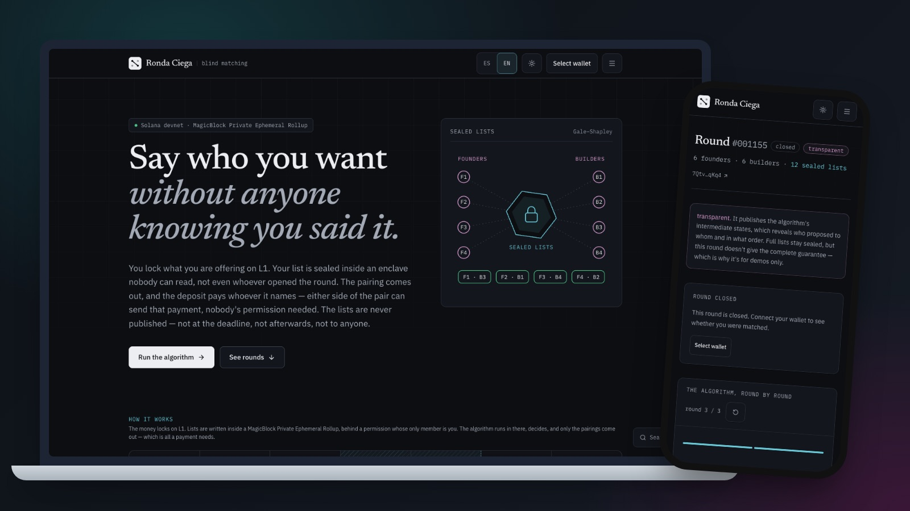
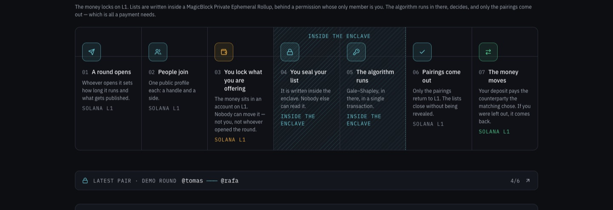
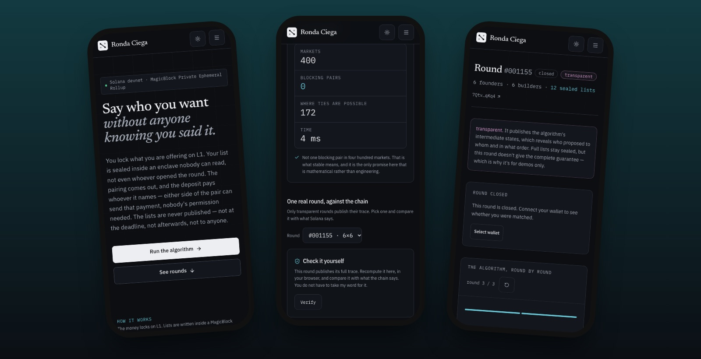
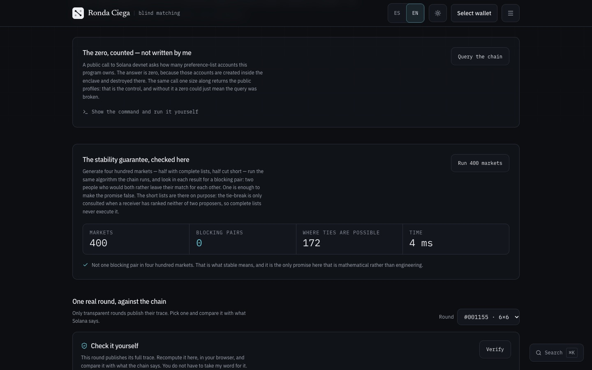
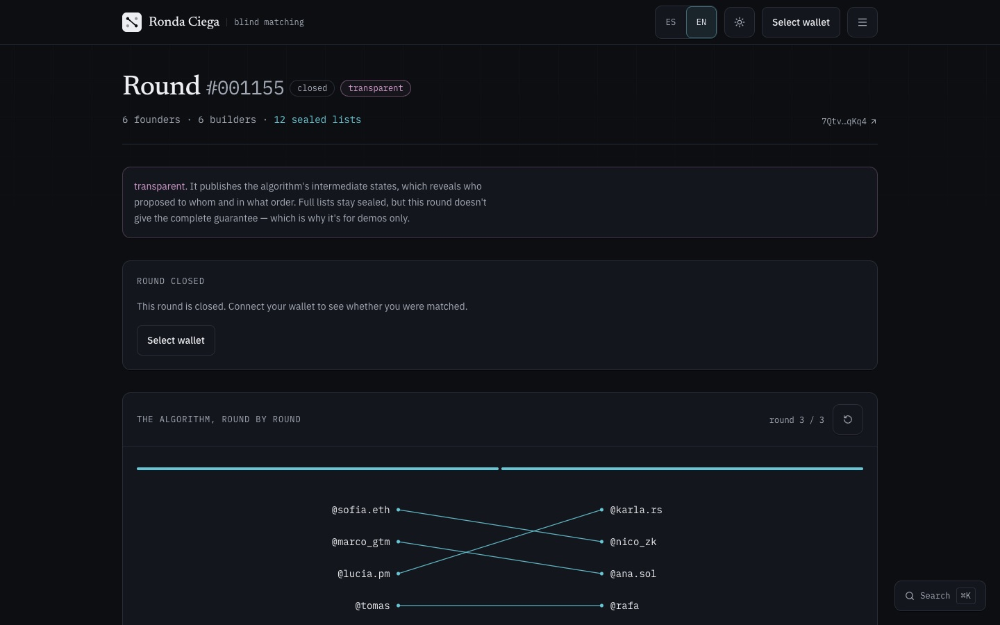
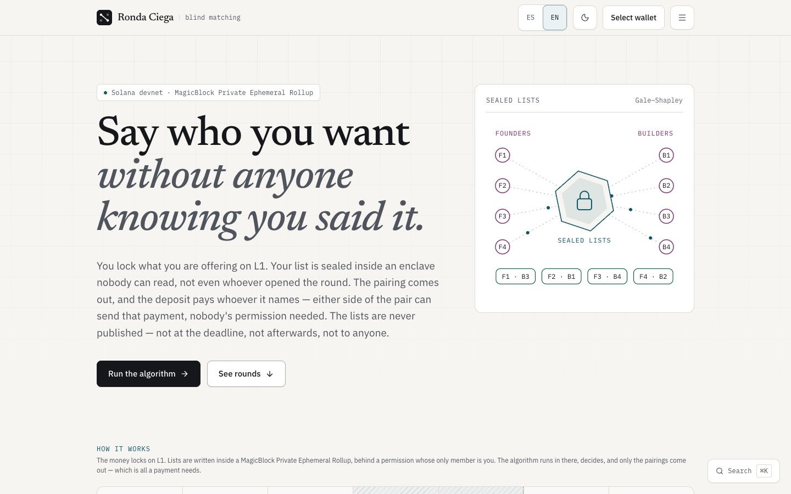
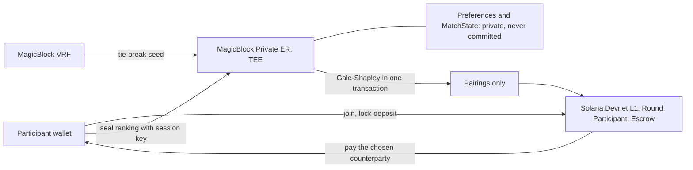

<div align="center">


# Ronda Ciega

### Blind stable matching on Solana. Say who you want — nobody ever learns that you said it.

[](https://ronda-ciega.vercel.app)
[](https://ronda-ciega.vercel.app/proof)
[](https://build.magicblock.app/?stage=blitz)
[](LICENSE)

[](https://github.com/ALFA117/ronda-ciega/actions/workflows/ci.yml)


<br/>



**[▶ Open the app](https://ronda-ciega.vercel.app)** · **[Run the proof](https://ronda-ciega.vercel.app/proof)** · **[How it works](#-how-it-works)** · **[Full design argument](docs/DESIGN.md)**

</div>

> [!NOTE]
> Runs on **Solana Devnet** with the MagicBlock TEE rollup — no real money moves. Built in one week for MagicBlock Solana Blitz v8 (theme *Global Startup Village*).

---

## 🎯 The problem

Gale–Shapley has solved **stable matching** on paper since 1962 — it's how medical residencies and school admissions are assigned. It isn't used much outside institutions because it needs a **trusted third party** that receives every preference list, runs the algorithm, and never leaks or sells those lists. That party rarely exists.

And a blockchain doesn't fix it by itself: a **commit-reveal** only buys secrecy *until a deadline*, because verifying it requires publishing the secret. A preference list has to stay secret **forever** — if it comes out later that I ranked you seventh, the social cost has just arrived late.

## 💡 The solution

Ronda Ciega replaces the trusted party with an **enclave**: a MagicBlock **Private Ephemeral Rollup** (TEE).

1. **Join a round** as a `founder` or a `builder`. Your profile is public — a handle and a link.
2. **Seal a ranking** of the other side. It's created *inside* the rollup, behind a permission whose only wallet member is you, and never committed to L1.
3. **The round closes** at its deadline; rankings move into private working memory.
4. **Gale–Shapley runs inside the TEE**, in a single rollup transaction, with ties broken by **MagicBlock VRF**.
5. **Only the pairings are published.** Rankings are destroyed inside the enclave, and an optional deposit pays whichever counterparty the matching chose.

> Four founders and four builders each seal a ranking. What comes out is only `F1 · B3`, `F2 · B1`, `F3 · B4`, `F4 · B2` — nobody, not even whoever opened the round, can read any list. *(Illustration from the landing page; labels are placeholders.)*

<div align="center">

</div>

## ✨ Check it rather than believe it

<div align="center">

<br/><sub>Mobile: landing · the proof page after a run · a settled transparent round.</sub>
</div>

<br/>

<table>
<tr>
<td width="50%"><p align="center"><sub><b>/proof</b> — generates 400 markets in your browser, runs the same matching the chain runs and searches every result for a blocking pair. No wallet.</sub></p></td>
<td width="50%"><p align="center"><sub><b>Round page</b> — a transparent round replays the algorithm round by round and recomputes the trace against what Solana says.</sub></p></td>
</tr>
<tr>
<td width="50%"><p align="center"><sub>Measured once on Devnet with <code>scripts/spike.ts</code>; the live slot rate of both chains is measured in your browser.</sub></p></td>
<td width="50%"><p align="center"><sub>Spanish / English, light and dark.</sub></p></td>
</tr>
</table>

Every round page also derives the address of each preference list and looks for it on **both** chains from your browser — with controls proving the query works, so a zero means "shielded", not "wrong cluster".

## 🧠 How it works



| Account | Visibility | Holds |
|:--|:--|:--|
| `Round` | public, L1 | deadline, counts, pairings, VRF seed, transparency flag |
| `Participant` | public, L1 | wallet, side, handle, link |
| `Preferences` | **private, rollup only** | one person's ranking |
| `MatchState` | **private, rollup only** | every ranking plus the algorithm's working state |

- **One transaction, whole matching:** proposal rounds run as a loop inside a single rollup transaction (671 ms wall clock measured from Mexico vs. 0.9–1.6 s *per round* when sent one by one).
- **Verifiable tie-breaks:** matching refuses to run until the VRF callback lands, and the seed is published so anyone can replay every tie-break.
- **Transparent rounds are opt-in:** animating the algorithm leaks proposal order, so normal rounds publish nothing but the pairings.
- **Honest privacy model:** TEE-enforced access control, not encryption. The result itself leaks by design, small pools leak by elimination, and there's no identity verification.

The full argument — session keys, autopilot, escrow, what a wallet can't simulate — is in **[docs/DESIGN.md](docs/DESIGN.md)**, and the spec in [docs/SPEC.md](docs/SPEC.md).

## ⛓️ On chain (Devnet)

| | |
|:--|:--|
| Program | [`5VBYCgdVwAELHuCwQgTXDB7czV9wvz65gYN3bCR9Nq9R`](https://explorer.solana.com/address/5VBYCgdVwAELHuCwQgTXDB7czV9wvz65gYN3bCR9Nq9R?cluster=devnet) |
| Demo round, **transparent** | [`7Qtv…qKq4`](https://ronda-ciega.vercel.app/round/7QtvEoTWT69VVyYHrwigmLcTevZtLfcavEWD8WdnqKq4) — 6×6, VRF fulfilled, settled in 3 proposal rounds |
| Demo round, **private** | [`3HKS…JCs3`](https://ronda-ciega.vercel.app/round/3HKShqud9GTngwHUbGDFrNFfFxBnFiJ8EQin9jw5JCs3) — same people, same rankings, same pairing, zero recorded frames |
| Demo round, **paid out** | [`8nMU…91dR`](https://ronda-ciega.vercel.app/round/8nMUQHBPfKW8xU528xjuVHb2ZSUxWkFwM3WTj7Rr91dR) — 3×2 with funds locked; escrow paid the matched seller and refused an unmatched one |
| Rollup | MagicBlock TEE ER — `https://devnet-tee.magicblock.app` |
| VRF queue | `5hBR571xnXppuCPveTrctfTU7tJLSN94nq7kv7FRK5Tc` |

## 🛠️ Stack

| Layer | Technology |
|:--|:--|
| Program | Rust · Anchor 1.0.2 · `ephemeral-rollups-sdk` 0.16.2 (Private ER permissions, VRF) |
| Frontend | Next.js 14 · React 18 · TypeScript · Tailwind CSS · Motion · Solana wallet-adapter |
| Tests | 55 Rust unit tests · frontend unit tests · devnet scripts for refusals, sessions, escrow and concurrency · GitHub Actions CI |
| Deploy | Vercel |

## 🚀 Run it locally

```bash
cd frontend && npm install && npm run dev
```

<details>
<summary><b>Program, scripts and tests</b></summary>

```bash
make build                         # compile the program (cargo build-sbf; anchor build panics on native Windows)
make idl                           # generate the IDL and TypeScript types
cargo test --package ronda-ciega   # Rust unit tests, host target, no validator
cd frontend && npm test            # frontend unit tests, no network
npx ts-node scripts/spike.ts       # full round end to end on devnet, with the privacy check
```

Devnet scripts that spend SOL and stay out of CI: `npm run negative`, `npm run negative:rollup`, `npm run session`, `npm run escrow`, `npm run concurrency`, `npm run operator-key`, `npm run verify`. What each one proves is described in [docs/DESIGN.md](docs/DESIGN.md#tests).

</details>

## 📂 Docs

| Document | What's in it |
|:--|:--|
| [docs/DESIGN.md](docs/DESIGN.md) | Why it can't be commit-reveal, signing, tie-breaks, privacy model, accounts, tests, design notes |
| [docs/SPEC.md](docs/SPEC.md) | The full design argument |
| [docs/PLAN.md](docs/PLAN.md) · [docs/ROADMAP.md](docs/ROADMAP.md) | Remaining work and known gaps |
| [docs/VIDEO.md](docs/VIDEO.md) | Demo video script |

## 🏆 Hackathon

Built for **[MagicBlock Solana Blitz v8](https://build.magicblock.app/?stage=blitz)** — theme *Global Startup Village*.

## 📄 License

MIT — see [LICENSE](LICENSE).

---

<div align="center">


**The pairing comes out. The lists never do.**

</div>
